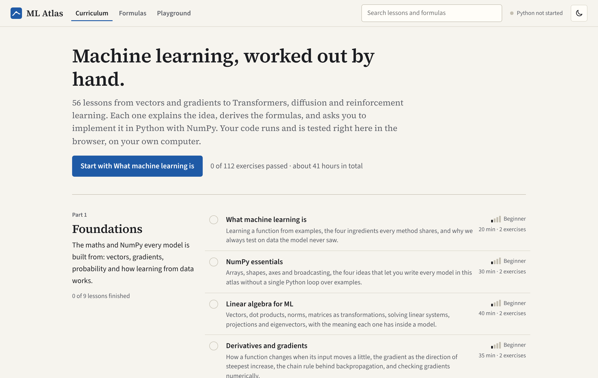
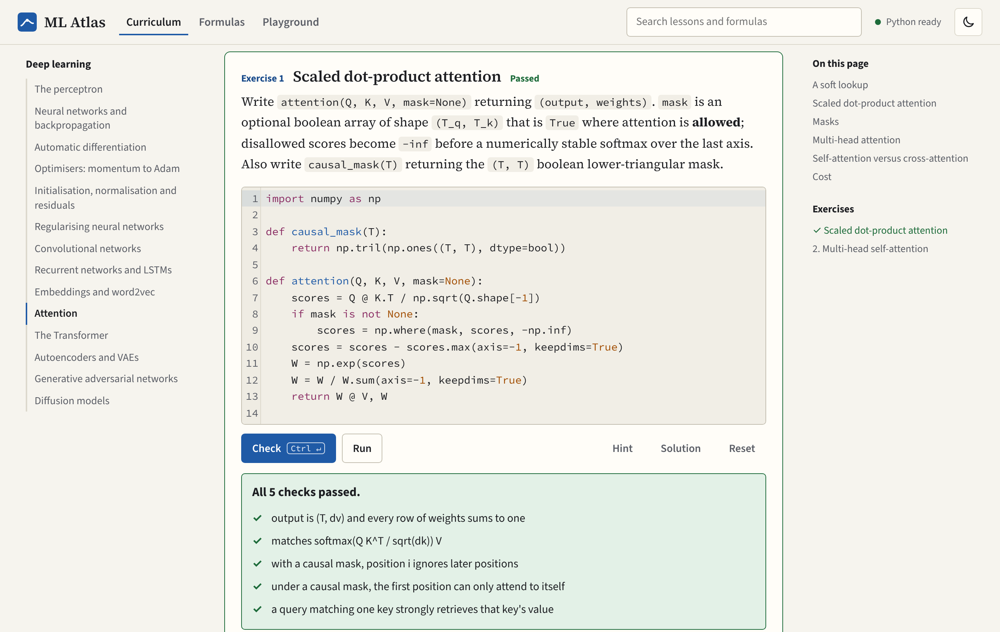
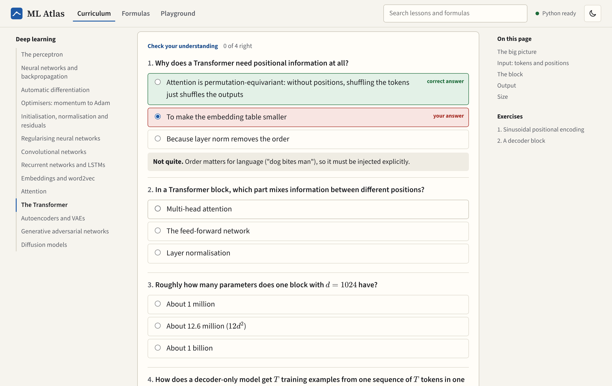
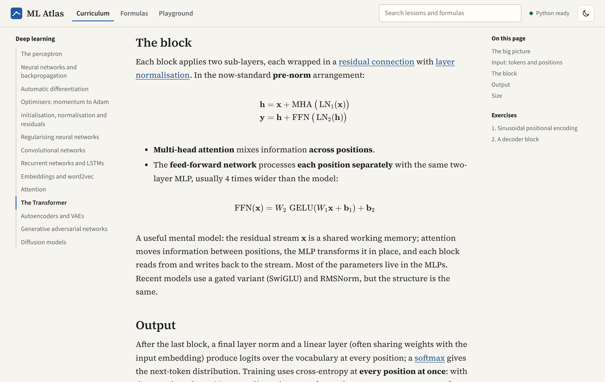
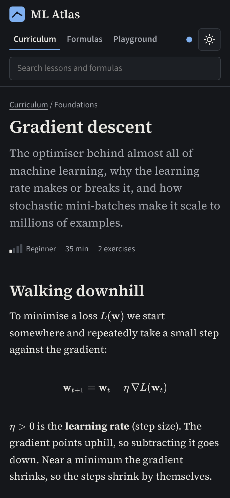

# ML Atlas

[](https://github.com/Epinnn14/ml-atlas/actions/workflows/ci.yaml)
[](https://epinnn14.github.io/ml-atlas/)

**Learn machine learning from first principles, in your browser.** 56 lessons from vectors and
gradients to Transformers, diffusion models and reinforcement learning. Each lesson explains the
idea, derives the formulas, asks questions with explained answers, and gives you Python exercises
that run and are tested right on the page, like an online compiler. Nothing is sent to a server:
Python and NumPy run inside your browser, so it also works offline on your own laptop.

**Open it:** [epinnn14.github.io/ml-atlas](https://epinnn14.github.io/ml-atlas/) ·
**Offline copy:** [ml-atlas-site.zip](https://github.com/Epinnn14/ml-atlas/releases/latest/download/ml-atlas-site.zip)



## What a lesson looks like

Every lesson has the same parts:

1. **The idea** in plain words, with the formulas written out and derived where it matters.
   Every named formula also appears on the searchable **formula sheet** (179 of them).
2. **Exercises.** You implement the method yourself with NumPy: least squares, a decision tree,
   backpropagation, attention, a DDPM step. Press **Check** and hidden tests run against your code,
   each reported as a sentence ("rows of P are distributions", "matches numerical gradients").
   Hints come one at a time; the solution is there when you are stuck.
3. **Check your understanding.** Multiple-choice questions that explain why each answer is right
   or wrong, aimed at the misconceptions people actually have.



<p align="center">


</p>

There is also a **Playground** for free Python with NumPy and matplotlib (figures are drawn on the
page), light and dark themes, and search across lessons and formulas. Progress and your code are
saved in your browser.

## Curriculum

Levels go from **Beginner** to **Senior**; each lesson shows its level, time and exercises.

| Part | Lessons |
|---|---|
| **1. Foundations** (9) | What machine learning is · NumPy essentials · Linear algebra for ML · Derivatives and gradients · Probability · Estimation, MLE and MAP · Gradient descent · Preparing data · Entropy, cross-entropy and KL |
| **2. Supervised learning** (13) | Linear regression · Overfitting and the bias–variance trade-off · Regularisation: ridge and lasso · Logistic regression · Softmax regression · Evaluating models · Cross-validation and model selection · k-nearest neighbours · Naive Bayes · Decision trees · Bagging and random forests · Boosting · Support vector machines |
| **3. Unsupervised learning** (6) | k-means clustering · Hierarchical clustering and DBSCAN · Gaussian mixtures and EM · Principal component analysis · Manifold learning, t-SNE and UMAP · Anomaly detection |
| **4. Deep learning** (14) | The perceptron · Neural networks and backpropagation · Automatic differentiation · Optimisers: momentum to Adam · Initialisation, normalisation and residuals · Regularising neural networks · Convolutional networks · Recurrent networks and LSTMs · Embeddings and word2vec · Attention · The Transformer · Autoencoders and VAEs · Generative adversarial networks · Diffusion models |
| **5. Advanced topics** (14) | Bayesian linear regression · Gaussian processes · Time series forecasting · Recommender systems · Multi-armed bandits · MDPs, value iteration and Q-learning · Policy gradients and PPO · Graph neural networks · Tokenisation and BPE · Large language models · Interpreting models · Calibration and uncertainty · Causal inference and A/B testing · Machine learning in production |

In total: 112 coding exercises, 224 quiz questions, about 41 hours of material.

## Run it on your own computer

**Easiest, no tools needed except Python 3:** download
[ml-atlas-site.zip](https://github.com/Epinnn14/ml-atlas/releases/latest/download/ml-atlas-site.zip),
unzip it, then double-click `start.bat` (Windows) or run `./start.sh` (macOS, Linux). Your browser
opens `http://localhost:8765`. The zip contains Python, NumPy and matplotlib for the browser, so no
internet connection is needed after the download. (A small local server is needed because browsers
do not run WebAssembly modules from `file://` pages.)

**From source** (Node.js 20 or newer):

```bash
git clone https://github.com/Epinnn14/ml-atlas.git
cd ml-atlas
npm install
npm run offline   # optional: keep numpy and matplotlib local (downloads the Pyodide release once, ~400 MB)
npm run dev       # http://localhost:5173
```

Without `npm run offline`, the Python runtime is still served locally and the packages are fetched
once from the Pyodide CDN and cached by the browser.

<p align="center"></p>

## How it works

- **Python in the browser.** [Pyodide](https://pyodide.org) (CPython compiled to WebAssembly) runs
  in a Web Worker, so a slow or endless loop never freezes the page. Code is stopped after 30 seconds
  or with the Stop button, which replaces the worker.
- **Tests.** Each exercise has a hidden test file of `test_*` functions; a small harness
  ([`src/py/harness.py`](src/py/harness.py)) runs your code, then each test separately, and reports
  its docstring with the failure message and your own traceback lines.
- **Lessons are Markdown.** One file per lesson in [`content/`](content), with KaTeX maths and a few
  HTML comments that mark formulas, exercises and quizzes. The site is a static Vite + React app;
  CodeMirror 6 is the editor.

### Writing or fixing a lesson

```markdown
---
title: Logistic regression
level: beginner            # beginner | intermediate | advanced | senior
minutes: 40
summary: One sentence shown in the curriculum.
---

## The idea
Text with $inline$ maths.

<!-- formula: Sigmoid -->
$$\sigma(z) = \frac{1}{1 + e^{-z}}$$

<!-- exercise: sigmoid | A stable sigmoid -->
What to implement.
~~~python starter
~~~
~~~python solution
~~~
~~~python tests
def test_values():
    """this sentence is what the learner sees"""
    assert approx(sigmoid(0.0), 0.5)
~~~
<!-- hint: One hint per comment, revealed one at a time. -->
<!-- /exercise -->

<!-- quiz -->
1. Question?
   - [ ] wrong option
   - [x] right option
   > Why it is right.
<!-- /quiz -->
```

Link to another lesson with `[text](#/lesson/<file-name-without-number>)`.

### Checks

```bash
npm run build   # lint every lesson (front matter, KaTeX, links, ids), type-check, build
npm run check   # run every exercise in Pyodide: the solution must pass all tests, the starter must fail
npm run e2e     # Playwright: every lesson on a phone and a desktop, solutions pass in the browser
```

CI runs all three on every push, deploys the site to GitHub Pages, and attaches the offline zip to
each tagged release.

## License

MIT, for both the code and the lessons.
